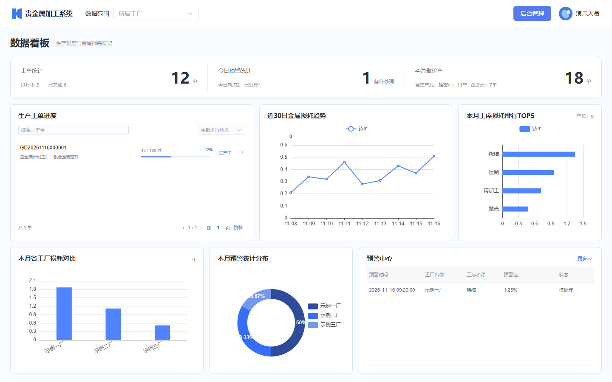
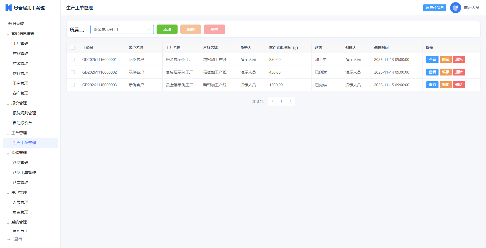
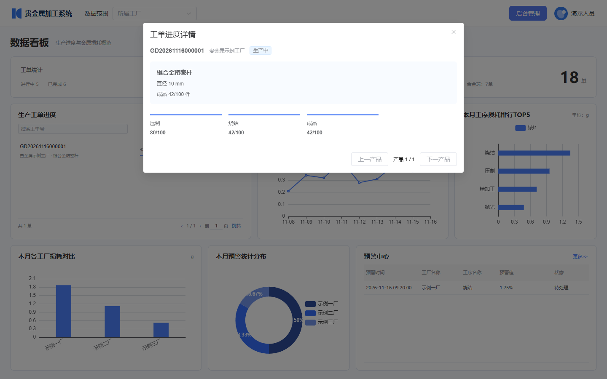
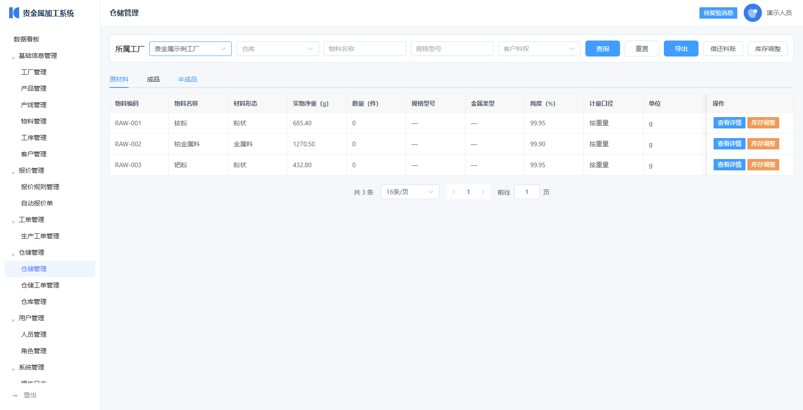
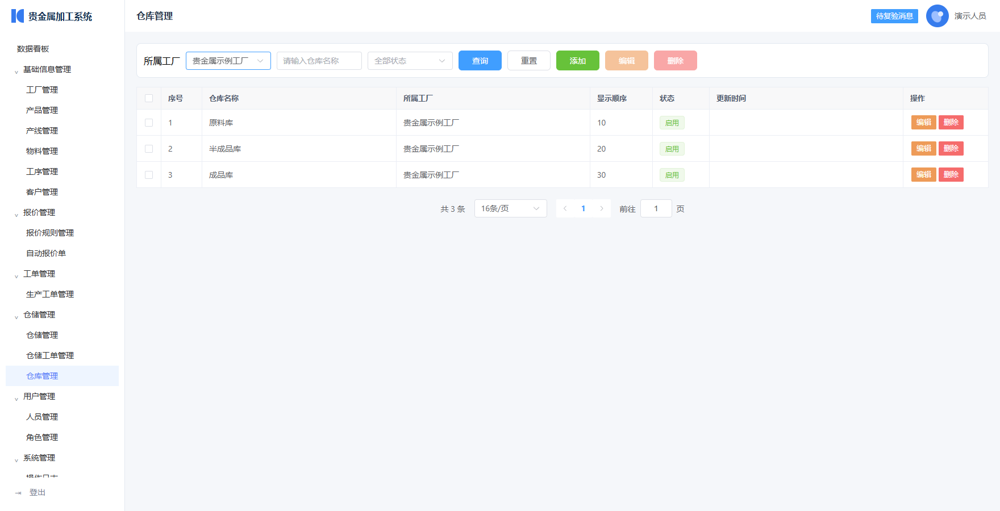
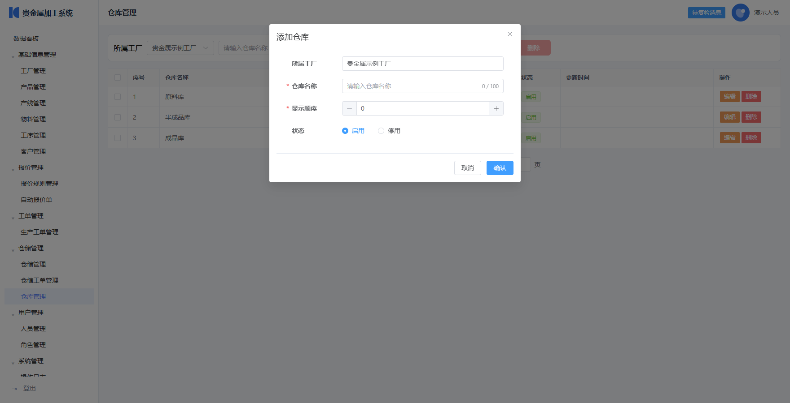
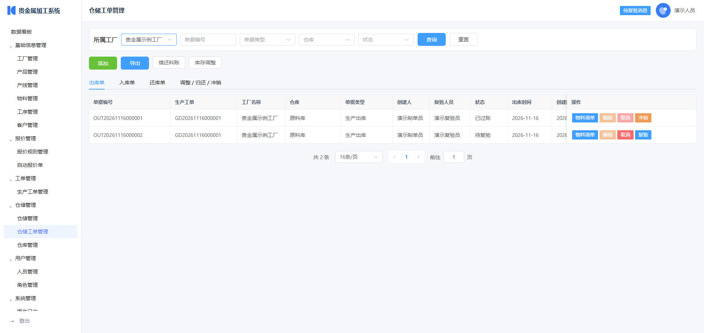
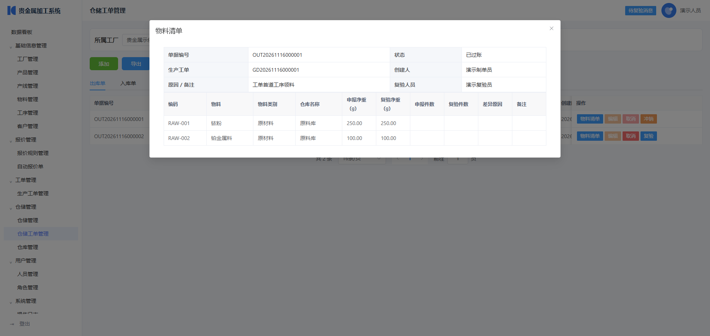
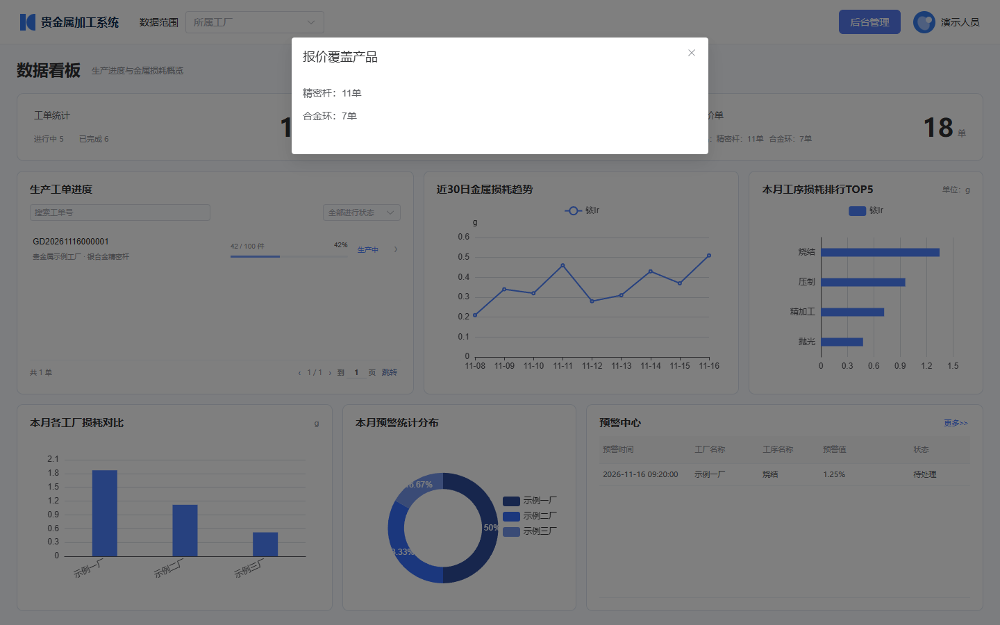
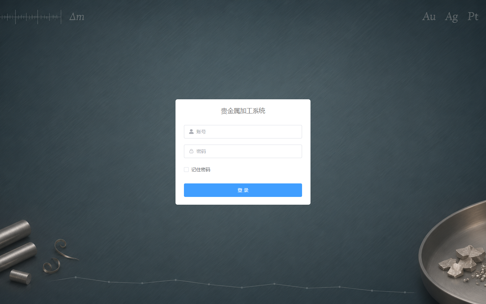

# 贵金属加工系统

基于若依、Spring Boot、Vue 3、MySQL 和 Redis 的贵金属生产管理系统。

[查看项目源码（development 分支）](../../tree/development)

## 项目操作手册

[阅读贵金属加工系统操作手册](docs/user-manual.md)，涵盖基础资料、报价、生产工单、仓储复验、损耗核对和材料借还。

## 运行截图

截图取自实际运行的前端页面，业务内容使用演示数据。

### 数据看板

### 生产工单管理

### 工单进度详情

### 原材料库存

### 仓库管理

### 新增仓库

### 仓储工单

### 出库物料清单

### 报价覆盖产品

### 登录页

## 功能

- 工厂、产线、产品、物料、工序、人员及角色管理。
- 产品体积计算、报价规则、自动报价及报价保存。
- 工单创建、审核、工序计划和工厂数据隔离。
- 原材料、半成品、成品库存与出入还库流水。
- 生产出库自动生成并绑定批次号，产出和还料复用未结算批次。
- 损耗结算、理论损耗预警、预警处理及数据看板。

批次号格式为工单号-毫秒时间-产品编号。新预警使用创建工单时保存的单件理论损耗，平均损耗严格超过理论值才预警，相等正常。仓储单据详情支持结算和整批冲销。

## 开发与运行

后端源码在 backend，前端源码在 frontend。后端使用 Java 21 和 Maven；前端使用 Node.js。数据库连接、缓存连接和鉴权配置须由部署环境提供，凭据不得提交到仓库。

后端构建：在 backend 目录执行 Maven package。前端构建：在 frontend 目录安装依赖后执行 npm run build:prod。数据库版本由 Flyway 管理，保留全部已执行迁移。

## 验证

当前版本通过 137 项后端测试、20 项浏览器测试，以及库存、自动批次、预警、并发和权限的真实接口验证。测试运行需要自行配置隔离的测试环境。

## 许可证

项目基于若依框架，保留上游 MIT 许可证和版权声明。
