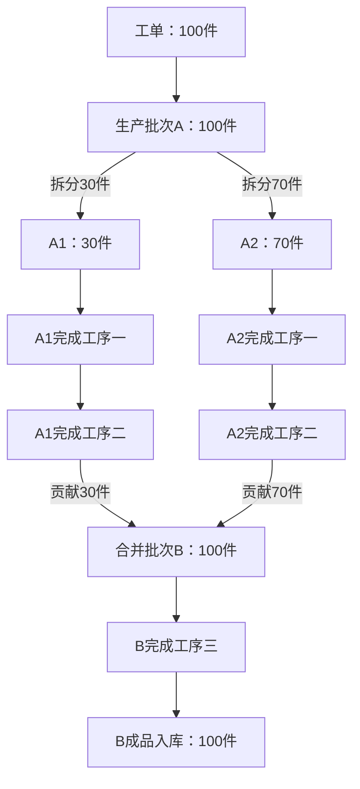

# 生产批次全流程沿用与拆分合并设计方案

- 日期：2026-11-12
- 状态：业务与技术设计稿，尚未实施
- 项目：heavyMetalSystem
- 本次交付：整理设计方案，不修改代码、数据库或真实业务数据。
- 依据：本次讨论确认的业务目标，以及当前工作区生产、仓储相关源码的静态核对。源码现状不代表运行中服务已部署或已验收。

## 1. 目标与设计结论

系统只保留一种面向用户的“生产批次”：代表一份可以独立流转的生产实物，可从首道工序沿用到成品产出。

每道工序的加工人员、投入、产出、退料、回收和损耗，记录在该生产批次的“工序加工记录”中。加工记录不是另一种批次，不再要求用户为每道工序建立新的批次编号。

核心规则：

1. 不拆分、不合并时，跨工序沿用生产批次编号。
2. 需要独立进度或独立流转时拆分，生成子批次，保留来源。
3. 加工阶段一致、符合条件的批次可以合并，生成新批次，保留各来源贡献。
4. 拆合之后不强行使用一个原编号；“贯穿全流程”通过连续身份与来源关系共同实现。
5. 拆合不增加生产完成量，不凭空增加库存，不自动改变料权或核销欠料。
6. 一个批次可以关联多道加工记录、多条库存明细、多张仓储单据。

第一版建议范围：同工厂、同工单产品组、同冻结工艺路线内的跨工序沿用、拆分、合并。跨工单合批、单件序列号、新的工序直接交接体系暂不扩展。

## 2. 已确认目标与建议边界

| 分类 | 内容 |
| --- | --- |
| 已确认目标 | 系统只有一种生产批次；批次跨工序；100件可分30、70独立生产，也可合并继续；能追溯到成品 |
| 推荐设计 | 拆合生成新编号；原批次退出当前流转、保留历史；工序活动独立为加工记录 |
| 第一版建议限制 | 同工厂、同工单产品组、阶段一致才能合批；优先复用当前仓储复验机制 |
| 待细化规则 | 在制拆分时实际投入及损耗的分配方法、计重阶段的计划件数口径、质量状态与权限映射、历史复杂来源迁移 |
| 尚未实施 | 本文所有新增表、接口、页面、迁移及验收方案 |

“同工单内合批”等限制属于推荐范围，不应描述为系统已经具有或业务已经永久确定的规则。

## 3. 业务对象及职责

| 对象 | 职责 | 示例 |
| --- | --- | --- |
| 生产工单 | 总生产目标、客户、产品组、冻结路线 | 生产100件 |
| 生产批次 | 一份实物的身份、当前阶段、流转和来源 | A1：30件 |
| 工序加工记录 | 某批次在一道工序的加工活动及平衡 | A1在工序二由张师傅加工 |
| 批次拆合记录 | 来源、结果、件数重量、原因、操作者 | A拆成A1、A2 |
| 库存明细 | 仓库、阶段、质量及实际余额 | A1在一号仓的30件 |
| 仓储单据 | 实际领料、入库、退料、交付及复验 | A1工序二领料单 |
| 材料来源与借还记录 | 实际材料来源、料权、借用归还关系 | 客户料、工厂供料及欠料 |

生产批次编号、库存明细编号、单据编号、加工记录编号各有用途。库存明细编号不再作为另一种“生产批次”展示。

## 4. 100件拆成30和70独立生产，再合并的完整流程

示例假定有三道连续工序，没有损耗、报废；拆分时已具备可确认的实物件数。前段只有原料重量时，按第8节处理计划量与实物量。

### 4.1 创建A

工单目标100件，创建生产批次A，计划100件。此时计划数不直接增加实物库存，实际投入仍通过领料确认。

### 4.2 拆分A

将A拆成A1：30件、A2：70件。

| 批次 | 状态 | 当前可用量 | 说明 |
| --- | --- | --- | --- |
| A | 已拆分 | 0 | 历史曾承载100件，不能再次使用 |
| A1 | 有效、待加工 | 30件 | 独立流转 |
| A2 | 有效、待加工 | 70件 | 独立流转 |

推荐统一采用“原批次整体退出，所有结果生成新批次”的拆分方式。即使只拆出30件，保留的70件也生成子批次，避免原编号同时代表整体和剩余量。

### 4.3 独立推进

A1完成工序一后进入工序二，批次号仍是A1；A2可以等待，也可以由另一人加工工序一。

| 批次 | 数量 | 已完成阶段 | 当前动作 |
| --- | --- | --- | --- |
| A1 | 30 | 工序一 | 工序二加工中 |
| A2 | 70 | 无 | 工序一加工中 |

允许30件先走，不要求工单100件全部完成前道才允许后道开工。A1完成不代表A2完成，也不代表工单该工序全部完成。

### 4.4 到达相同阶段

A1、A2分别完成工序二并确认交接后，两者均已完成“工序一、工序二”，下一工序都是工序三，才具备合批的阶段条件。

如果A1已完成工序二，而A2只完成工序一，不能直接合并后进入工序三，否则会把A2未完成的工序错误标为已完成。

### 4.5 合并成B

| 来源 | 贡献件数 | 贡献重量 |
| --- | --- | --- |
| A1 | 30 | 实际确认的转入重量 |
| A2 | 70 | 实际确认的转入重量 |
| B合计 | 100 | 两者转入重量之和 |

A1、A2状态改为已合并，可用量为0；B为有效批次，承接相同阶段，等待工序三。合并不重复记录工序一、二的产出。

### 4.6 B到成品

B完成工序三并成品入库，成品生产批次仍为B。查B能追到A1、A2、A及各道工序；查A能追到所有分支和最终成品去向。



图中的工序节点是同一批次的加工过程，不是新批次。

## 5. 分次生产与拆批的区别

| 场景 | 处理 |
| --- | --- |
| 先产30、后产70，全部完成后一起进入下道 | 同批分次产出，不必拆批 |
| 已完成30件要先进入下道 | 拆出独立批次，剩余70件继续原阶段 |
| 两份实物交不同人员独立加工和交接 | 建议拆批，独立责任和进度 |
| 当前工序材料不足 | 当前加工记录追加领料，不必拆批 |
| 整批换人 | 办理加工交接，保留人员历史，不必换批次 |
| 整批进入下一工序 | 沿用批次，新建下一道加工记录 |

需要独立流转、独立进度或独立处置时才拆批。分次产出不自动产生子批次。

同一批次分次加工时，应保存已完成与未完成的实物明细，批次整体不能把100件都标为完成。30件要离开整体进入下道时，提供“拆出已完成部分并进入下一工序”的连续操作。

## 6. 拆分规则

### 6.1 前置条件

- 来源批次有效，待拆实物存在且余额可核实。
- 明确阶段、件数、重量、质量状态、位置和保管人。
- 不能使用已拆分、已合并、已取消来源的历史数量。
- 与本次实物有关的占用、待复验、未确认交接必须先处理或在受控事务中协调。

### 6.2 守恒与阶段

```text
来源可拆实际件数 = 所有结果实际件数之和
来源可拆净重 = 所有结果净重之和
```

纯拆分不产生损耗。发现称量差异时，独立记录差异及承担原因，不能藏在拆分里。

实测重量与账面分配重量分别标记。按比例分配不是实测，尾差必须明确归属，合计保持一致。

已经完成30件、未完成70件时，必须分别继承真实阶段。不能把完整批次的完成标志复制给所有结果。已有产出只记录一次，拆分不再次报工。

### 6.3 加工中拆分

优先在开工前、阶段交接或产出验收后拆分。加工中拆分必须明确已投入、已产出、未完成在制、余料、损耗及责任的分配。

“先产30件并提前流转”的推荐流程：

1. 确认30件已经完成本工序并通过验收。
2. 拆出30件子批次，继承该工序的已完成阶段。
3. 剩余70件及其在制余额归入另一子批次。
4. 原加工记录保留，记录结果对原活动的承接和来源。
5. 不重复生成原领料、已确认产出或欠料流水。

同一历史加工活动可以关联多个拆分结果，通过明细分配来源，不需要复制整条加工记录。尚未完成的责任与余额通过明确交接继续记录。

无法核清实际分配时应阻止操作，不自动按件数比例猜测全部投入和损耗。

## 7. 合并规则

### 7.1 推荐前置条件

| 条件 | 第一版建议 |
| --- | --- |
| 工厂、工单产品组 | 相同 |
| 产品身份 | 金属种类、规格、纯度等匹配 |
| 路线 | 同一冻结路线 |
| 已完成阶段、下一工序 | 一致 |
| 质量 | 均允许继续加工 |
| 实物 | 已确认、可交接、未重复占用 |
| 进行中任务 | 已结束或完成明确交接 |
| 待处理单据 | 涉及实物的单据已处理 |

阶段按冻结路线中的工序节点及顺序判断，不只比较工序名称。同名工序可能重复出现。

### 7.2 结果

- 创建新批次，保存所有来源贡献。
- 来源参与数量退出可用余额，历史不删除。
- 新批次继承共同完成阶段，后续人员重新安排。
- 原人员、质量、加工、材料来源历史完整保留。
- 合并不记为工序产出，不改变总库存。

### 7.3 部分参与

例如30件与70件中的20件合并：

```text
A2：70 → A21：20 + A22：50
A1：30 + A21：20 → B：50
A22：50继续独立流转
```

界面可一步操作，后台拆分与合并必须原子提交，不能只成功一半。

### 7.4 混合后的来源精度

能够证明B分别来自哪些批次及其贡献，不代表混合后再取10件就能证明每件具体来自哪个来源。

无单件识别时，后续拆出部分保留混合来源范围；使用比例分配须标明账面规则，不能伪装为单件实测追溯。本方案不引入单件序列号。

## 8. 件数、重量及加工平衡

| 字段 | 含义 |
| --- | --- |
| 工单计划件数 | 最终生产目标 |
| 批次计划件数 | 分配给该批次的目标，不是库存 |
| 实际件数 | 已形成并确认的实物件数 |
| 实际净重 | 实际投入、产出或交接重量 |
| 参考件数 | 计重阶段的参考信息，不冒充实际件数 |

生产100件但投入1000g粉料时，可以分配30、70的生产目标，实际投入重量必须另外确认，不能自动认定为300g、700g。尚无实际件数时，不能凭计划数增加库存。

不改变件数的工序按适用范围核对：

```text
投入实际件数 = 合格产出 + 报废 + 未完成 + 其他明确处置
```

融定等改变形态或计量方式的阶段，不机械要求投入、产出件数相等，按重量及工艺规则核对。

每道加工记录核对投入、产出、退料、回收、在制及损耗；辅料如参与实物平衡，须计入投入。生产损耗与交接差异分别记录，不能重复扣减。

例如70件报废2件，合批只能贡献68件，30+68=98件。工单目标仍是100件，缺口通过补产或异常完工明确处理，不能合批时补成100件。

## 9. 跨工序、仓储与材料借还

### 9.1 进入下一工序

1. 当前工序产出确认。
2. 明确进入下道的实物范围。
3. 整批沿用编号，部分先拆批。
4. 校验冻结路线及可用阶段。
5. 建立本批次的下一道加工记录，指定人员。
6. 办理实际领料或交接，后续记录产出与损耗。

结束工序加工不等于生产批次完成。子批次工序完成不等于工单该工序全部完成。

同一份1000g材料经过三道工序，三道的投入相加不能被当成3000g外部投入。

### 9.2 仓储边界

优先保留现有仓储复验：实际出仓走领料，实际回仓走入库或退料。位置未变的纯拆合只记录批次归属变化，不虚构出入库。移库保留生产批次编号。

一个批次可有多条库存明细，保存仓库、阶段、质量、数量重量及来源单据。查询可汇总，扣减必须落到具体明细。批次余额不能成为另一套可独立修改的库存账。

库内拆合需要可审计的身份余额转移：来源减少、结果增加，但全厂总实物不变，料权和来源份额同步承接。

第一版不新增工序直交体系；如后续支持不经仓库直接交接，须另外定义双方确认及在制责任，不能无单据改状态。

### 9.3 材料借还

拆合及跨阶段沿用保留材料来源、料权和已形成借还关系。不得因为合入客户批次就把所有料变为客户自有料，不在每次工序领用中重复记同一笔债。

欠料变化仍由实际借用、归还和既定业务规则触发。生产完成、产品交付、材料欠料结清分别判断。

## 10. 状态与完工规则

### 10.1 批次生命周期

| 状态 | 含义 |
| --- | --- |
| 有效 | 继续加工、流转或按规则拆合 |
| 已拆分 | 全部实物已转到子批次，仅保留历史 |
| 已合并 | 全部实物已转到合并结果，仅保留历史 |
| 生产完成 | 已达到成品阶段，仍可库存和交付 |
| 已取消 | 未实际执行的空批次取消 |
| 异常终止 | 明确原因终止，余额仍须处置 |

### 10.2 分离管理的维度

- 加工状态：待加工、加工中、部分完成、本工序完成、待下一工序。
- 质量状态：按项目质量规则管理，不与生产状态混用。
- 位置和保管责任：仓库或在制位置、责任人。
- 交付状态：已交付和待交付余额。

批次有效不表示无条件可出库，仍检查质量、余额、占用和位置。

### 10.3 完工条件

批次生产完成：全部必需工序和验收完成，产出、在制、退料回收及异常处置清楚，无阻碍完工的待处理记录。

工单正常完工：按产品组目标及有效加工证据核对所有分支，不能仅因历史父批次已拆分、已合并就判定完成；数量不足不能自动补齐。

完工后的成品如需拆合库存身份，应作为成品阶段的受控拆合，保持已完成阶段，不重新记生产完成量。

## 11. 数据结构建议

以下为逻辑模型，不是已实施的表结构或SQL。

| 对象 | 主要字段 | 实现建议 |
| --- | --- | --- |
| 生产批次主表 | ID、编号、工厂、工单、产品组、路线版本、计划量、生命周期、版本、创建来源、创建人时间 | 新增统一身份 |
| 工序加工记录 | 批次ID、工序节点、人员、状态、投入产出、退料回收损耗、开始结束时间 | 优先改造现有execution |
| 拆合操作主记录 | 类型、原因、操作者、时间、请求号、状态、撤销引用 | 复用现有幂等模式 |
| 拆合来源和结果 | 操作ID、来源批次、目标批次、实物引用、件数重量、阶段 | 一对多及多对一 |
| 实物分配与余额关联 | 批次、加工阶段、位置、库存或在制引用、数量重量、来源分配 | 承接现有库存和在制流水 |
| 仓储单据关联 | 生产批次ID、加工记录ID，必要时明细归属 | 扩展现有单据 |
| 生产事件 | 批次、加工记录、来源实物、单据、数量重量、冲销引用 | 扩展现有事件 |

约束：

1. 批次主表不强制绑定唯一工序和唯一加工人员。
2. 多来源合并不能只用一个parent_id表达。
3. 不强制单一最初批次，多个来源可以汇入一个结果。
4. 加工中部分完成必须有阶段和余额明细，不能只靠批次主表一个current_step字段。
5. 已有加工活动经拆分关联多个结果时，使用来源分配，不复制已记账事实。
6. 关联使用ID，编号仅展示；不解析编号推断血缘。
7. 汇总余额可缓存，但必须由有效流水重建并与库存一致。
8. 来源、阶段、权限及余额由服务端核验，不能信任客户端快照。

编号建议统一使用PB-日期-流水号。A、A1、A2、B为本文示例别名，不要求真实编号嵌套增长。

## 12. 操作接口与一致性

建议覆盖创建批次、详情及余额查询、进入工序、追加领料、拆分、合并、结束工序、生产完成、追溯、撤销和请求结果查询。具体URL随现有接口规范确定。

### 12.1 写入要求

- 拆合携带请求号、来源版本、原因、结果分配及实物引用。
- 锁定相关批次及实际库存/在制余额；服务端重新计算可用量。
- 来源退出、结果建立、余额分配、追溯、事件和审计在同一事务完成。
- 部分合并包含的拆分一并提交，失败全部回滚。
- 幂等请求只能产生一次结果；请求结果未知时先查询，不盲目生成新请求。
- 并发请求不得造成重复使用或负库存。

### 12.2 防循环

生产批次跨工序保持同一ID是合法行为。加工记录来源链和拆合来源链仍不得形成循环；不能把批次自身沿用误判为自我投入。

### 12.3 撤销

无下游使用时可按权限撤销；已有下游加工、拆合、交付时先逆序处理。保留原记录和撤销记录，不直接删除历史。恢复余额需校验相关单据和加工状态。

### 12.4 权限

复用现有工厂隔离、生产、仓储和复验机制，明确拆合及撤销权限。能领料不自动等于能拆合任意批次。复验人对应具体加工记录的有效人员。

## 13. 页面设计

### 13.1 工单批次列表

展示批次号、产品、计划量、实际余额、阶段、位置、状态、来源和操作。默认当前有效批次，历史可展开。A、A1、A2、B不能相加成300件。

### 13.2 领料

入口分为“新建生产批次并领料”“已有生产批次领料”。已有批次再区分进入下一工序、当前阶段首次开工、当前工序补料。

显著展示已完成阶段、本次工序和加工人员。不能用一个“补领料”动作同时表达补料和进入下一工序。

### 13.3 拆批

展示来源余额、阶段位置、质量、每份计划件数/实际件数/净重、合计差额、分配依据、原因及结果预览。加工中拆分补充已完成和未完成部分的承接。

### 13.4 合批

展示各来源阶段、件数重量、质量、参与量及不合格原因，预览新批次与剩余来源。默认全量合并；部分参与时联动拆分。

### 13.5 入库与结束

入库选择生产批次及对应加工记录，填本次实际产出。原“结清批次”拆成“结束本工序加工”和“完成生产批次”。

### 13.6 详情追溯

提供当前信息、拆合来源、加工履历、仓储履历、材料来源、最终去向及异常。图上区分同批加工推进与不同批次拆合关系。

## 14. 当前系统现状与差距

当前主流程中的metal_production_execution绑定order_step_id和processor_id，实际上是单工序加工批次。已有投入产出事件、分次累计、来源库存、阶段检查、损耗结算和防循环基础，但不能直接等同于本方案的全流程生产批次。

| 领域 | 当前静态证据 | 需要改变 |
| --- | --- | --- |
| 身份 | execution绑定工序及人员 | 新增生产批次，execution作为加工记录 |
| 建批 | 新领料可自动创建execution | 创建批次及首道加工记录 |
| 补料 | 已有OPEN execution继续领料 | 区分补料与进入下一工序 |
| 分次产出 | 累计数量重量并限制剩余计划 | 复用，增加部分实物阶段及拆出承接 |
| 来源 | 来源库存、sourceExecutionId及加工事件 | 扩展显式拆合和贡献数量 |
| 拆合 | 已查看主路径未见完整显式拆合机制 | 增加事务、余额、来源及撤销 |
| 结算 | 关闭execution结算该道加工 | 工序结束与批次完成分离 |
| 库存 | 每次入库有独立ST编号 | 明确库存明细与生产批次区别 |
| 统计 | 以execution产出及事件汇总 | 不重复统计拆合，区分外部投入和内部流转 |

不能仅把executionId改名为batchId完成改造，因为两者业务粒度不同。

## 15. 具体改造清单

路径相对于项目根目录。

| 位置 | 主要改造 |
| --- | --- |
| backend/ruoyi-admin/src/main/resources/db/migration/V70__production_execution.sql | 当前结构证据；通过新增迁移扩展，不改写已执行历史迁移 |
| backend/ruoyi-metal/src/main/java/com/ruoyi/metal/service/ProductionExecutionService.java | 建批、ensureExecutionForOutbound、linkedExecution、validateDocument、postDocument、close、completeStep、工单完工及报工查询 |
| backend/ruoyi-metal/src/main/java/com/ruoyi/metal/service/ProductionSourceBalances.java | 加工记录来源保留，增加拆合来源分配及防循环语义，避免重复记来源 |
| backend/ruoyi-metal/src/main/java/com/ruoyi/metal/service/StorageOrderService.java | 单据关联生产批次与加工记录，候选项、状态、复验人员、退料来源、冲销及待处理单据校验 |
| backend/ruoyi-metal/src/main/java/com/ruoyi/metal/service/StorageLedgerService.java | 库存生产批次归属、库内身份转移、入出库移库及交付来源 |
| backend/ruoyi-metal/src/main/java/com/ruoyi/metal/service/StorageReservationService.java | 预占上下文及拆合占用校验，禁止占用失效来源 |
| backend/ruoyi-metal/src/main/java/com/ruoyi/metal/service/ProductionOrderService.java | 工单编辑、路线冻结、版本及迁移口径联动，实施时复核具体调用 |
| backend/ruoyi-admin/src/main/java/com/ruoyi/web/controller/metal/ProductionExecutionController.java | 批次及加工记录语义，新增拆合、进入下一工序、追溯和撤销接口 |
| backend/ruoyi-admin/src/main/java/com/ruoyi/web/controller/metal/StorageOrderController.java | 仓储参数及查询契约联动 |
| frontend/src/views/metal/production-order/ProductionFlow.vue | 全流程批次、工序履历、拆合入口、追溯和操作状态 |
| frontend/src/views/metal/production-order/BatchCloseDialog.vue | 区分结束工序与完成批次 |
| frontend/src/views/metal/storage-orders/OrderEditor.vue | 新建/已有生产批次，下一工序与补料分开 |
| frontend/src/views/metal/storage-orders/LineEditor.vue | 阶段、来源、实际余额及退料关联 |
| frontend/src/views/metal/storage-orders/useReservations.ts | 请求参数及占用上下文 |
| frontend/src/views/metal/storage-live/client.ts | 批次、加工记录与候选项数据契约 |
| frontend/src/views/metal/storage-inventory/index.vue | 生产批次展示与库存明细区分 |
| backend/ruoyi-metal/src/main/java/com/ruoyi/metal/service/DashboardService.java | 工序完成量、有效批次、在制及库存统计 |
| frontend/src/views/metal/production-order/DashboardProductionProgress.vue | 新汇总口径与展示 |

### 15.1 旧入口核对

当前仓库还存在frontend/src/views/metal/process-batch/index.vue、warehouse-common/WarehousePage.vue及ContinuousBatchPlanning等旧逻辑。

实施前追踪菜单、路由、控制器和实际调用：仍开放的写入入口必须统一规则；历史查询可以保留并标明历史，不能让旧入口继续创建另一套生产批次。本文未完成旧路径全量审计，不能据此直接删除旧代码。

### 15.2 统计口径

- 工序完成量来自有效加工产出，不来自拆合转移量。
- 有效批次数只计当前可流转批次，不计已退出的父批次。
- 在制、半成品库存、成品及交付按实际位置分类，不重复累计。
- 工单外部投入不累加每道内部领用。
- 报废、损耗、退料、回收、交接差异各按有效事件核算。

## 16. 历史迁移与切换

不能按同一工单直接把全部旧execution合为一个全流程批次。独立加工、多来源、分次流转可能产生多种真实关系。

建议：

1. 新流程新增生产使用统一模型。
2. 旧execution保留为历史加工记录。
3. 根据实际库存、有效事件及来源建立映射，不凭编号猜测。
4. 证据明确的关系才自动归并，复杂来源保留可证明关系。
5. 在制切换前核对库存、加工余额、占用和待复验单据。
6. 无法核实的在制关系先保留查询，实物确认后再切换。
7. 迁移不重新记账，不重复生成产出、出入库或借还。

切换对账：实物件数重量、在制、已确认产出、损耗退料回收、料权欠料、待处理单据及来源映射。通过隔离环境演练并保留回退路径后，才安排正式切换。

## 17. 验收场景

以下为待执行场景，不表示测试已经通过。

| 编号 | 前置与操作 | 预期结果与观察证据 |
| --- | --- | --- |
| B01 | A整批经过三道工序 | 编号不变；三道独立加工记录、单据、人员可查 |
| B02 | 同一工序先产30再产70 | 累计100；不自动生成子批次；剩余计划及重量正确 |
| B03 | 已完成30件提前进入下道 | 正确拆出30与剩余70；各自阶段正确；无重复报工 |
| B04 | A1、A2交不同人独立生产 | 进度、交接、投入产出及责任独立 |
| B05 | 30、70均完成工序二后合批 | B100；来源可用量为0；来源贡献可查 |
| B06 | 不同阶段尝试合批 | 拒绝并说明原因；没有任何余额或身份部分变更 |
| B07 | 30与70中的20合批 | B50及剩余50；拆合一并成功或回滚 |
| B08 | 件数30+70，重量单独确认 | 两个维度守恒；分配重量与实测标记正确 |
| B09 | 70件报废2件后合批 | 只能合98；报废有记录；工单缺口仍存在 |
| B10 | 粉料阶段计划100件，按30/70分目标 | 不增加实际件数库存；重量另行分配 |
| B11 | 同一请求重复提交或超时重试 | 仅一笔有效拆合和余额变化，可查询原结果 |
| B12 | 两人并发使用同一来源余额 | 不超用、不负数；失败操作无部分写入 |
| B13 | 从成品B向前追溯 | A1、A2、A及各道加工、来源单据可查 |
| B14 | 从A向后追溯 | 所有拆合分支、成品和交付去向可查 |
| B15 | 拆合前后查询看板和工单 | 完成量不增加，不将历史父子批次重复相加 |
| B16 | 借料后跨工序及拆合 | 原借还余额不重复增加、不自动核销，来源保留 |
| B17 | 来源存在预占或待复验 | 阻止冲突或原子协调；旧单据不指向失效余额 |
| B18 | B已经下游加工后撤销上游合批 | 拒绝直接撤销，提示先逆序处理 |
| B19 | 无下游的拆合撤销 | 来源余额恢复，结果退出，历史及撤销关系保留 |
| B20 | 同批跨工序与非法来源环路 | 合法沿用成功，真实循环被拒绝 |
| B21 | 已混合B再次拆出10件 | 保留混合来源范围，不伪造单件精确来源 |
| B22 | 越权、跨工厂及伪造来源参数 | 服务端拒绝，不泄漏或更改其他工厂数据 |
| B23 | 历史在制迁移 | 迁移前后实物、产出、损耗、料权欠料一致 |

### 17.1 复用现有验证资源

后续实施优先扩展现有ProductionExecutionServiceTest、ProductionDocumentBindingTest、ProductionSourceBalancesTest、ProductionSourceCycleTest、ProductionSourceRegressionTest、StorageOrderServiceTest、StorageLedgerServiceTest、StorageReservationServiceTest和DashboardProductionProgressTest。

前端优先复用storage-orders、storage-reservation、production-receipt-binding、production-guards-live和dashboard-production-progress等现有测试，补充100→30+70→100完整隔离场景。

数据库事务、并发与真实余额需通过隔离数据库验证；模拟接口或静态页面通过不能证明真实库存和借还一致。测试不得写入正式业务数据。

## 18. 实施顺序与交付标准

| 阶段 | 内容 | 完成标准 |
| --- | --- | --- |
| 一 | 统一生产批次身份，execution作为加工记录 | 同一批次跨工序沿用 |
| 二 | 仓储、复验、占用、材料来源和统计接入 | 实物账、在制和生产身份一致 |
| 三 | 拆分、同阶段合并、部分合并 | 100→30+70独立生产→100合批完整走通 |
| 四 | 并发、幂等、撤销、异常及迁移 | 无重复用料、来源丢失或统计虚增 |
| 五 | 页面、菜单与旧入口统一 | 用户只接触一种生产批次 |

可分阶段开发，但不能仅上线拆合按钮，而余额、来源、统计和撤销仍沿用不兼容的旧规则。

## 19. 实施前需细化的业务决定

1. 计重工序如何承接30/70的生产目标，实际件数在哪一道开始确认。
2. 加工中拆分时，可使用哪些投入、损耗及实物分配依据；哪些情况必须先结清阶段。
3. 当前质量状态、复验和直接交接的适用边界；第一版继续走仓储复验。
4. 生产完工后的成品拆合权限及交付约束。
5. 现有菜单和旧流程的实际启用范围，以及在制工单迁移批次。

这些细化不能改变已确认的核心目标：一种生产批次、跨工序沿用、独立拆分、同阶段合并和完整追溯。

## 20. 本次检查范围与限制

本次仅整理设计文档，并基于前述源码静态核对列出改造位置。未修改业务代码、SQL或业务数据，未执行测试、迁移、部署或运行验收。

实际实施前仍需按当前源码和数据库版本复核完整调用链、旧入口、并发及复杂历史来源。所有验收项均为待执行计划，不作为已完成能力的证明。
