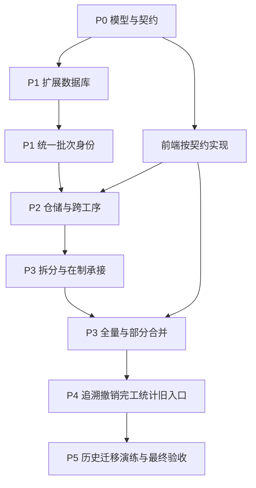

# 生产批次改造开发任务与阶段验收计划

- 日期：2026-11-12。
- 状态：原始任务基线。P0—P5已有分阶段实现与隔离验收记录；P5已交付隔离演练及切换准备，正式历史生产身份承接与发布尚未完成；后续正式快照全量结构演练见第13节。
- 依据：[生产批次全流程沿用与拆分合并设计方案](生产批次全流程沿用与拆分合并设计方案-2026-11-12.md)。
- 本文保留原始任务与门槛；实际实现、验证和未完成项以各阶段验收文档为准，不能把原计划中的将来时当成当前实现状态。
- 三个子代理分别只读拆解数据库、后端、前端；主代理统一依赖、集成顺序与验收门槛。
- 任务编号用于后续认领与验收，不代表已经完成；未指定人员和工期，不将工作量猜测当成交付承诺。

## 1. 实施原则

1. 用户只使用一种生产批次；现有execution优先保留为工序加工记录。
2. 跨工序保持批次身份；拆合产生新身份和可核查的来源贡献。
3. 复用仓储复验、生产事件、权限及幂等模式，不新建独立可修改的实物总账。
4. 一次写入功能必须同时具备权限、版本/并发、幂等、失败回滚及小范围回归验证，不推迟到末期补齐。
5. 开发阶段完成不代表可部署。完整链路、旧入口、迁移及回退验证通过之前，不切换正式业务。
6. 本计划保留原方案B01—B23验收编号；QA任务执行它们，不重新定义另一套业务标准。

## 2. 必须先处理的结构问题

### 2.1 库存不能直接复制

当前迁移V68的库存来源约束包含工厂、来源单据、来源明细的唯一关系，来源不能为空。纯库内拆合不能简单复制同一来源库存行，也不能伪造生产入库单绕开约束。

源码依据：[V68__storage_ledger.sql](../backend/ruoyi-admin/src/main/resources/db/migration/V68__storage_ledger.sql)中的origin_document_id、origin_line_id及uq_storage_origin。跨行份额守恒不能仅由MySQL CHECK保证，必须配合事务、锁、版本和对账查询。

P0应比较并确定以下一个方案：

- 在现有库存明细下增加生产批次份额关联，物理总余额仍以现有库存账为准；份额之和必须等于该库存余额，预占和扣减落到具体份额。
- 明确可审计的内部身份转移来源模型，再扩展库存来源约束，使新旧来源类型都有结构化证据。

优先评估第一种，但本计划不把未评审的物理结构当成最终决定。不能由数据库、后端、前端各自实现不同方案。

### 2.2 加工记录并非永远只属于一个结果

开工时一条加工记录可以归属一个批次；加工中拆出已完成30件、剩余70件继续加工时，历史投入产出必须被多个结果承接。

只加execution.batch_id不能完整表达这种关系。需要实物分配/承接明细：历史事件不复制，已完成产出、剩余在制、余料及责任分别有证据。后续新加工记录归属新批次，不能让退出流转的原批次继续无限领料。

### 2.3 并行工作的前提

先固定ID、状态、阶段、份额引用、计划/实际/参考量、请求号、版本和错误语义。前端可以基于契约开展页面工作，但模拟数据通过不能替代真实事务与余额验收。

## 3. 总体顺序与阶段门槛

| 阶段 | 顺序及目标 | 数据库/后端/前端任务 | 阶段验收标准 |
| --- | --- | --- | --- |
| P0 | 范围、模型、契约冻结 | PL-01～03、DB-01、BE-01；FE-01参与评审 | 两个结构问题有明确决定；23场景有归属；旧入口清单完整；待定规则不会被实现者自行猜测 |
| P1 | 扩展结构、统一身份 | DB-02～03、BE-02、FE-01～02 | 隔离库升级成功；生产批次与工序记录分离；存量数据保持；主列表与详情可查询 |
| P2 | 不拆合的跨工序闭环 | BE-03～04、FE-03、FE-06基础部分、QA-01 | 同批三道工序编号不变；补料与下道分开；库存、复验、退料及来源正确 |
| P3 | 拆分、合并和在制承接 | BE-05～07、FE-04～05、QA-02 | 100→30+70独立生产→B100成品；部分合并、已产30先走、同阶段判断全部通过 |
| P4 | 来源、撤销、统计、完工和旧入口收口 | BE-08～10、FE-06～08、QA-03 | B01—B22相关回归通过；拆合不虚增产量/欠料；已用下游不能直接撤销；旧写入口不绕规则 |
| P5 | 历史演练、全链路验收及切换准备 | DB-04～05、BE-11、QA-04～05 | B23及全部回归通过；新旧余额一致；复杂来源有清单；切换与回退边界明确；仍不等于自动发布 |

P1—P4为集成验收顺序，任务可交错开发。例如BE-08的来源逻辑应在P3同时实现，不允许先交付丢失来源的拆合；P4做全链路验收和收口。

## 4. P0准备任务

| ID | 任务及交付物 | 依赖 | 验收 |
| --- | --- | --- | --- |
| PL-01 | 按菜单→页面→接口→服务→表清点新旧生产批次写入口；列出仍启用、仅历史、可下线项及证据 | 无 | process-batch、旧warehouse-common、ContinuousBatchPlanning等逐项有结论，不能仅因文件存在就删除 |
| PL-02 | 明确计重阶段计划拆分、在制分配、质量状态、权限、成品拆合边界；记录业务决定和拒绝条件 | 无 | 100件计划与实际实物分开；30完成/70在制有可操作模型；未确认规则明确阻断对应功能 |
| PL-03 | 形成共享契约：批次、加工记录、工序节点、库存份额、数量单位精度、状态、版本、幂等、操作结果、错误码及兼容范围 | PL-01、PL-02、DB-01、BE-01 | 数据库/后端/前端采用同一字段及状态；补料、进入下道、拆合、撤销请求有示例 |

## 5. 数据库任务包

以下DB编号为本汇总文档统一编号。

| ID | 任务/具体交付 | 前置依赖 | 验收标准 |
| --- | --- | --- | --- |
| DB-01 | 清点实际迁移与约束：生产execution/event、库存/料权/预占、旧批次；确定库存身份方案和加工分配关系，输出字段与约束设计 | PL-01、PL-02 | 不形成第二套实物账；能表达同一来源多个结果、多个来源一个结果和部分在制承接 |
| DB-02 | 新增迁移：统一批次身份、execution关联、拆合操作及来源结果、必要实物分配关联；保留历史迁移不改写 | PL-03 | 空库及有旧数据隔离库升级通过；历史查询仍可用；唯一性、工厂归属、非负和引用约束适配；ID和精度沿用项目规范 |
| DB-03 | 索引及并发约束：批次编号、请求号、来源/目标、库存份额、活动工序和版本；输出锁定对象与固定锁顺序 | DB-02、BE-01 | 重复请求唯一；来源结果按双向可查询；并发不会超分配；禁止未清理数据即强制历史字段非空 |
| DB-04 | 迁移候选和歧义查询、旧记录到批次映射、可重复执行的受控回填方案；输出迁移前后核对结果 | DB-02、DB-03、BE-08～10 | 不按工单盲目归并；不重新生成账务事件；无法证明的来源列为待人工核查，不虚构血缘 |
| DB-05 | 在制切换与回退演练：库存/在制/欠料/占用/待审单据快照、冻结点、切换步骤、失败恢复策略 | DB-04、QA-03 | 重跑不重复绑定；余额零差异或有经核实的明确差异；新写入产生后不能声称直接回旧程序安全 |

正式迁移版本号实施时查当前最大版本后分配，不在计划中预占V号。数据库任务含新增SQL的自检与隔离迁移验证，但本次不编写或执行SQL。

## 6. 后端任务包

路径均相对于项目根目录；不要求每个任务都新建一个服务类，应按现有层次复用。

| ID | 任务/涉及位置 | 依赖 | 验收标准 |
| --- | --- | --- | --- |
| BE-01 | 全链路影响清点和接口草案；ProductionExecutionController、StorageOrderController与调用方；明确旧executionId保留为加工记录ID | PL-01、PL-02，配合DB-01 | 无简单全局改名；调用方、单据、人员、库存、来源、报表、测试均有任务归属 |
| BE-02 | 统一批次创建/查询与首道加工记录；ProductionExecutionService、ProductionOrderService | PL-03、DB-02～03 | 原子创建身份和必要首道记录；未领料不凭计划增加库存；跨工厂及伪造路线拒绝 |
| BE-03 | 整批进入下一工序与当前工序补料；调整ensureExecutionForOutbound、linkedExecution、validateDocument及阶段规则 | BE-02 | 三道同批ID不变、加工记录不同；同名不同顺序不混淆；人员归属本工序；部分下道要求先拆批 |
| BE-04 | 仓储及复验接入：StorageOrderService、StorageLedgerService、StorageReservationService；调整候选、份额、退料、冲销、移库和交付 | BE-02、DB-03；与BE-03联调 | 实物只扣一次；库存/份额一致；待复验和占用不悬空；退料引用真实来源；原ST库存编号不冒充生产批次 |
| BE-05 | 整体拆分：全部分配为新批次，原批次退出；库内及尚未开工的已确认实物 | BE-03～04、BE-08基础 | 件数重量守恒；部分留存亦建结果；无虚构入库、报工或债务；失败无半笔结果 |
| BE-06 | 部分完成/在制拆分：已产30独立进入下道、剩余70在制责任承接；扩展加工分配，不复制历史事件 | BE-05、PL-02已明确分配依据 | 30有完成阶段，70无虚假完成；原加工不继续无归属领料；历史产出只统计一次；原料退回及余料归属可查 |
| BE-07 | 同阶段全量与部分合并；部分参与由拆分和合并同事务完成 | BE-05～06、BE-08基础 | 30+70=B100；30+20=B50及余50；不同阶段/产品/质量拒绝；结果继承共同阶段而非重复报工 |
| BE-08 | 来源份额与双向追溯、防循环；ProductionSourceBalances及生产事件；材料料权借还传播 | BE-02、DB-03；与BE-04～07同步迭代 | 同批跨工序合法；真实来源环路拒绝；混合后拆出不伪造单件来源；客户料/厂供料及欠料不重复变化 |
| BE-09 | 拆合撤销、工序结束与批次完成、工单完工；close、completeStep及相关单据保护 | BE-03～08 | 无下游撤销恢复余额且保留历史；已领用下游先逆序；98件不能正常完成100件目标；结束工序不关闭全流程批次 |
| BE-10 | 看板/报工/库存汇总与旧写入口收口；DashboardService、生产流程查询、PL-01清单 | BE-03～09 | 拆合不虚增产出、外部投入或在制；有效批次不累加历史父子；仍开放旧接口不能绕规则，历史查询保留 |
| BE-11 | 历史映射读取与切换适配：ProductionExecutionService、StorageOrderService、查询及迁移工具；返回历史未映射的不可操作原因 | BE-02～04、BE-08～10、DB-04映射 | 旧记录能查询且不猜测归属；未映射在制不能误入新写入；映射不新增业务流水；与DB-05共同演练切换及恢复 |

每个BE写任务自带：权限/工厂、版本冲突、幂等重放、非法参数、失败回滚及对应业务回归。相关锁顺序与DB-03一致。不要先完成“正常写入”再把一致性作为末期可选任务。

BE-08分两次交付以消除依赖歧义：基础部分在P2与BE-04一同完成，验证同批跨工序来源、借还及防循环；扩展部分在P3先确定拆合贡献分配，再供BE-05～07调用，P4完成双向追溯整体验收。因此BE-05～07依赖的是来源分配基础，不依赖尚未完成的最终追溯页面或报表。

## 7. 前端任务包

| ID | 任务/涉及位置 | 依赖 | 验收标准 |
| --- | --- | --- | --- |
| FE-01 | 数据契约及状态层：storage-live/client.ts、storage-orders/model.ts、useReservations.ts等实际调用处 | PL-03 | 生产批次ID与加工记录ID分离；份额引用按契约；重复点击/结果未知可恢复，不创建新请求盲重试 |
| FE-02 | 工单统一批次列表与详情：ProductionFlow.vue及必要局部组件 | FE-01、BE-02查询 | 当前有效批次默认展示，历史展开；计划/实际/参考分开；单据与人员历史可查 |
| FE-03 | 领料、下道和补料：OrderEditor.vue、LineEditor.vue、useReservations.ts及复验展示调用方 | FE-01～02；真实验收BE-03～04 | 显示已完成和本次工序；改选释放原占用；人员来自本工序；只按具体可用实物扣料 |
| FE-04 | 拆分窗口及已完成30先走入口；在制分配确认 | FE-02、BE-05～06 | 每份件数重量、阶段、差额、实测/分配依据可见；前端提示之外仍由服务端校验；不自动复制完成状态 |
| FE-05 | 全量/部分合并窗口，阶段兼容及原子操作结果展示 | FE-02、FE-04、BE-07 | 兼容来源可选，不兼容原因清晰；30+20预览含剩余50；版本变更后刷新重核；超时可查原结果 |
| FE-06 | 加工结束/批次完工/撤销与追溯；BatchCloseDialog.vue、ProductionFlow.vue | FE-02、BE-08～09 | 操作名称不混淆；来源贡献、工序履历与下游可查；撤销失败原因清楚且不误显示成功 |
| FE-07 | 库存、看板与报工展示；storage-inventory/index.vue、DashboardProductionProgress.vue | BE-10、FE-01 | ST明细与PB身份区分；100→30+70→100不显示300件；单位和参考件数正确 |
| FE-08 | 菜单、旧页面入口、导入导出和历史查询兼容核对；process-batch/index.vue、warehouse-common/WarehousePage.vue及PL-01识别项 | PL-01、BE-10、FE-03～07 | 不再暴露第二种生产建批；旧记录仍能查；无按钮仍可绕过服务端的假防护 |

前端可在契约固定后制作交互并使用模拟数据，但阶段验收必须接真实隔离后端。共享表单、状态、库存预占及加工流程文件应指定单一写入负责人，避免多个实施代理同时编辑同一文件。

## 8. 验证与迁移任务包

| ID | 内容与依赖 | 验收/交付证据 |
| --- | --- | --- |
| QA-01 | P1—P2隔离基线；依赖DB-02～03、BE-02～04、FE-03 | B01、B02基础、B10、B16、B20、B22；数据库有效事件、库存/在制、借还前后结果，不只HTTP成功 |
| QA-02 | P3拆合场景；依赖BE-05～08、FE-04～05 | B03—B09、B11—B12、B17、B21；含真实库并发、故障回滚、超时查询重放；100主链及部分合并截图/数据证据 |
| QA-03 | P4全链路回归；依赖BE-09～10、FE-06～08 | B13—B15、B18—B20、B22并复跑相关主链；验证逆序撤销、完工缺口、统计及旧入口 |
| QA-04 | 历史迁移演练；依赖DB-04～05、BE-11、QA-03 | B23；迁移前后实物、在制、产出损耗、料权欠料、占用待审单据及来源映射核对；歧义清单 |
| QA-05 | 汇总交付和切换预案；依赖QA-01～04 | B01—B23逐项证据、未解决项、目标版本、部署顺序、冻结点及恢复边界。发布另行安排，不因计划完成而自动执行 |

复用原方案列出的ProductionExecutionServiceTest、ProductionSourceBalancesTest、ProductionSourceCycleTest、StorageOrderServiceTest、StorageLedgerServiceTest、StorageReservationServiceTest、DashboardProductionProgressTest及现有storage/production前端测试。实际按变更选择对应测试，不对纯文档任务运行业务测试。

## 9. 100件主链的阶段验收记录模板

每次验收记录请求号、实际批次ID、加工记录、库存/份额ID、单据、件数重量、操作前后余额、有效事件及追溯结果。

| 步骤 | 操作 | 必查结果 |
| --- | --- | --- |
| 1 | 创建A，计划100并确认实际投入 | 计划不凭空成为库存；有首道加工记录 |
| 2 | A拆A1=30、A2=70 | A不可重复用；结果余额、阶段及来源守恒 |
| 3 | A1先完成工序一进入工序二，A2仍工序一 | A1编号不变；A2不继承A1进度；工单工序不整体提前关闭 |
| 4 | 两批分别完成工序二并确认交接 | 阶段相同、质量允许、无冲突占用，重量各有依据 |
| 5 | 合成B100 | A1/A2可用0，B100；来源贡献30/70可查；无重复产出欠料 |
| 6 | B完成工序三及成品入库 | 成品批次B；向前查A1/A2/A，向后查成品去向 |
| 7 | 看板、报工、库存和借还核对 | 不累加父子历史为300件；内部流转不算外部投入；库存与在制不重计 |

另设“先产30再拆”的分支验收：A先产30，拆出已完A1及剩余在制A2；A1可下道，A2可继续完成70；不重复历史INPUT/OUTPUT，余料与在制责任明确。该分支属于核心范围，不能以开工前拆批通过替代。

## 10. 建议的并行认领方式

| 工作组 | 可以独立推进 | 必须等待 |
| --- | --- | --- |
| 数据库 | P0模型、迁移设计、隔离数据及历史歧义分析 | 最终DDL等PL-03；正式回填等来源规则及演练 |
| 后端生产 | 身份、跨工序、拆合、完工及追溯 | 写入实现等契约/结构；拆合等真实余额接入 |
| 后端仓储 | 份额、占用、复验及借还来源适配 | 先定库存身份承载；与生产共享服务文件须协调 |
| 前端 | 契约固定后列表、表单、预览、追溯交互 | 真实集成验收等对应BE接口及隔离环境 |
| 验证 | 场景与数据准备，可与实现同步 | 并发和余额结论等真实库；最终验收等完整链路 |

不要把“可以并行开发”当成“可以跳过集成门槛”。拆合核心写入和库存扣减若分别实现，必须共同确认事务边界。

## 11. 每个任务的完成定义

- 修改范围和调用方齐全，接口、页面、单据、统计及历史行为同步。
- 写入业务的不变量、权限、事务、幂等、并发、异常回滚有相应验证。
- 验收证据注明静态、模拟、真实隔离库或浏览器，不相互冒充。
- 旧数据兼容和影响明确；无法证明的历史关系不猜测。
- 文档与实际最终接口、字段和状态一致，不仅保留初稿。
- 无正式数据写入、部署或发布，除非后续明确安排对应执行工作。

## 12. 当前状态与下一步

P0—P4已推进，见同目录生产批次P0至P4文档。P5已交付历史候选/歧义扫描、受控空记录映射、历史只读保护、隔离迁移及恢复演练、全链路证据矩阵和切换回退准备，见《生产批次P5实施与隔离验收-2026-11-12.md》。待定历史来源只阻断相关写入，不自动推断批次归属。

各阶段已执行的业务测试和隔离迁移见相应验收记录；该阶段记录时尚未部署，后续本地上线见第15节。正式历史全量演练及来源歧义处理仍是发布门槛，不以合成隔离样本通过替代。

## 13. 正式快照后续进度（2026-11-12）

已从正式V80库取得只读一致性快照，恢复至两个全新3323隔离库并验证138表一致；工作副本真实执行V81—V84，独立236项账实核查无差异，原99张业务表全部原列原行保留。完整结果见[正式快照全量演练与验收](生产批次P5正式快照全量演练与验收-2026-11-12.md)。

本轮剩余已具体化为19条历史加工的身份/来源/计划与在制承接决定（当前工具安全候选0）、4张未处理单及6笔欠料的原责任保留、stock6超大账面数量的实际核实，以及普通角色授权和正式切换时重新冻结/快照。结构升级与账实一致通过不等于历史自动映射通过；未对正式库apply或切换服务。

## 14. 已批准的历史承接与上线前验收（2026-11-12）

用户已确认订单4目标100+100、订单7/11各总100、原加工人、按账面余额承接以及旧单14/24/40由原人核实。已实现V85、受控LEGACY_ADOPT、旧事实只读投影、工序覆盖与历史产出贡献承接，详见[历史承接实现与隔离验收](生产批次历史承接实现与隔离验收-2026-11-12.md)。

全新正式快照副本已完整验证三单跨工序到成品；订单11的4880库存与11786.70在制分别流转，最终16666.70g/100件，无重复投入或新增欠料。后端227项0失败0跳过、前端24项、真实HTTP和真实浏览器通过；独立43项续作与239项通用对账均无差异。普通旧成品交付、原来料复验、新成品交付冲销已回滚验证。另一个全新副本验证正式部署同一提交前断言及三单同事务承接。

本地正式切换须另记实际备份、恢复、迁移与运行结果；隔离模拟产出不复制到正式库。

## 15. 本地上线完成（2026-11-12）

已按用户授权完成本地正式V80→V85、订单4/7/11历史承接及前后端切换。切换前重新只读备份并在新隔离库验证138表全量恢复相等；五个迁移保持原99张业务表旧列不变；三单同事务承接前后冻结断言通过。正式只承接100/50/11786.70g在制与原stock17的4880g库存，没有复制隔离模拟成品。

页面仍为http://localhost:5173，后端8080；正式HTTP17项读取、历史写入409、8旧入口503及真实页面只读展示通过。具体批次、备份摘要、运行证据和回退边界见[本地上线与历史承接验收](生产批次本地上线与历史承接验收-2026-11-12.md)。旧单14/24/40保留原状态与原责任，不自动审核、重绑或清欠。
